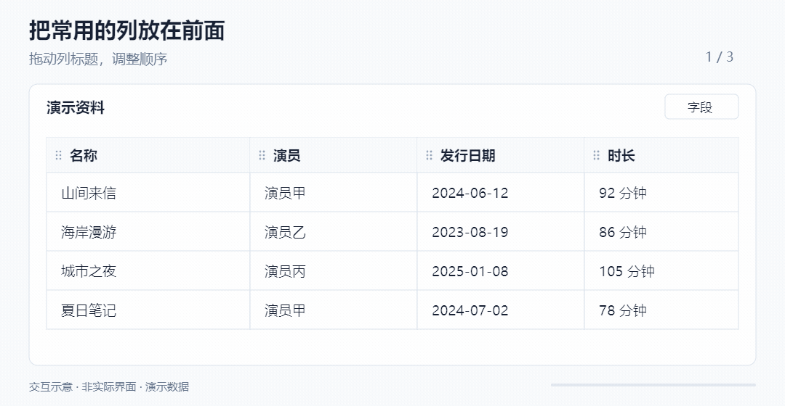
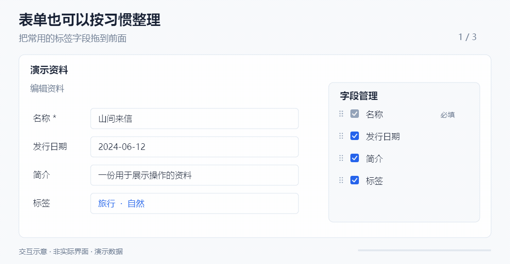
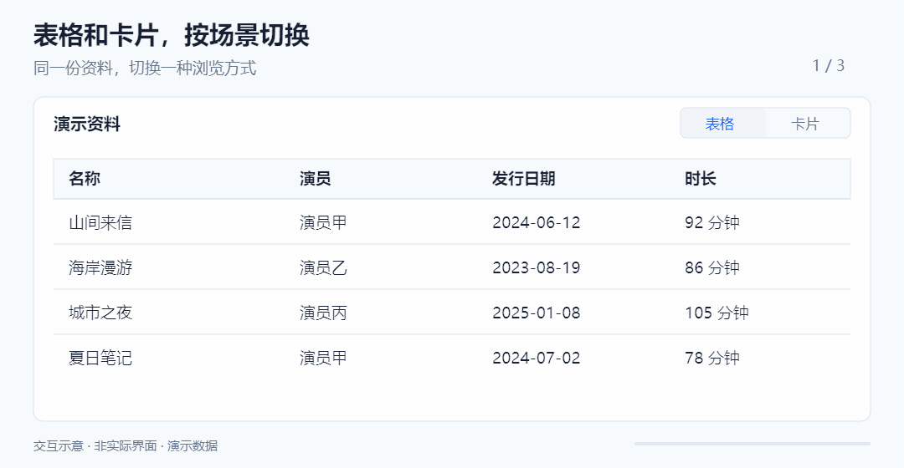

# Memex · 示例资源库

**把散落在文件夹、网页和记忆里的资料，整理成一个能关联、能筛选、能随手打开的资源库。**

这里以影片资料为例：一条记录可以连着本地视频、演员、标签和来源网页。想找东西时，既可以看封面、查表格，也可以顺着这些关联继续找。

> [!IMPORTANT]
> **当前资源库是用于体验和参考的示例。** 本页介绍已发布的 **0.3.0**，配套网页助手为 **0.1.2**。**不保证在本版本中录入、导入的数据能在后续版本中继续使用，也不承诺兼容迁移。** 请保留重要原文件及备份，先用少量资料体验。

[下载安装](https://github.com/aiml1025/my-new-app/releases/tag/v0.3.0) · [第一次使用](#第一次使用) · [详细使用指南](docs/使用指南.md) · [反馈问题](https://github.com/aiml1025/my-new-app/issues)

## 这种资源库，究竟管什么？

文件夹告诉你“文件在哪里”，资源库还帮你记住“它是什么、和谁有关、从哪里找到”。

比如，你可以先记下一部影片，补上演员和标签，留下资料站链接；以后有了本地文件，再把文件挂到这条记录上。同一个演员可以关联多部影片，改一次资料，其他地方打开的也是同一条记录。

| 你想做的事 | 当前可以怎样做 |
| --- | --- |
| 整理手里的影片 | 建立条目，关联视频文件、封面、演员、标签及来源链接 |
| 先记资料，以后再补文件 | 先建条目；本地文件不是整理资料的前提 |
| 少抄一些网页信息 | 在已适配的网页采集资料，再到确认页核对、填写 |
| 按自己的习惯浏览 | 调整表格、卡片和表单的字段、顺序及显示方式 |
| 沿关联找东西 | 按演员、标签等关联条件筛选，而不只搜索当前记录的文字 |

**这里的“采集”指提取网页资料，不是下载影片。** 添加一个链接，也不代表已经下载文件或补全资料。当前的网页识别、增强和采集只覆盖已有适配，主要示例是 JavDB；不能把任意网站都当成可采集来源。

## 自定义视图：让信息按你的习惯摆放

### 表格：常用列放前面，不常用的先藏起来

拖动列调整顺序和宽度，在字段面板里选择显示哪些信息，再配上筛选和排序。**隐藏字段只影响显示，已有数据仍然保留。** 列宽、字段顺序与显隐、筛选排序会保存，重启后可以继续使用。

### 表单：整理资料时，也可以少看一些无关字段

表单同样支持调整字段顺序和显隐，把常用信息放到顺手的位置。创建时的必填字段会保留。

### 卡片：用封面找东西

同一份资料可以切换成卡片浏览，选择要显示的字段，调整封面的比例和显示方式。双击卡片可以继续编辑，右键也能打开条目或在新标签页查看。

*以上动图均为简化的交互示意，使用演示数据，并非实际界面录屏。*

当前“自定义视图”主要是调整现有页面的展示。每类列表共用一套当前配置，表格和卡片各自保留布局；还没有多套命名视图管理和分组功能。重启会回到预设的视图类型，保留各自的布局设置。

## 嵌套窗口：顺着关联看，不必来回找页面

整理一部影片时，可以直接打开关联演员的资料，在弹出的表单里查看或编辑，再继续打开其中的关联项。关闭上层弹窗，就能回到之前的工作位置。

适合这种连续操作：**打开影片 → 查看演员 → 修改资料 → 回到影片继续整理。** 需要并排查看时，也可以把支持独立打开的条目放到页面或新标签页中。

## 多端实时同步，也能用 HTTP 打开

桌面窗口、浏览器标签页和网页里的编辑浮层，都可以连接**同一个正在运行的本体**。一处提交的名称、标签或关联修改，会反映到其他正在查看这份数据的页面，无需来回重复录入；同一列表的视图配置也会同步。

最容易的体验方式：打开条目，点击表单工具栏的 **“在默认浏览器中打开”**，就能同时在桌面和浏览器里查看、编辑。

- **本机浏览器**：通过本体提供的 HTTP 地址访问。常用端口是 `3001`，被占用时可能改变，以实际打开的地址为准。
- **其他设备的浏览器**：网络及防火墙允许时，可把地址中的 `127.0.0.1` 换成运行本体那台电脑的局域网 IP，保留端口和页面路径。
- **使用边界**：本体需要一直运行；这里共享的是同一台本体的数据，不提供多台独立安装之间的云同步或离线合并。资源库管理、本地视频导入、调用本机播放器等仍在桌面端完成。

当前没有面向公网的账号和访问权限管理，请只在可信环境中访问，**不要直接把服务端口暴露到公网**。具体地址示例见[浏览器访问说明](docs/使用指南.md#浏览器访问与同步)。

## 顺着关联筛选：从“找名字”到“找相关的东西”

假设你记得的是“某个演员演过、带某个标签的作品”，而不是文件名。筛选可以从当前条目继续选关联对象的字段。

| 想找什么 | 可以使用的条件 |
| --- | --- |
| 某位演员出演的影片 | 在影片列表按“演员”筛选 |
| 带指定标签、某段时间发行的影片 | 组合“标签”与“发行日期”条件 |
| 演过某类作品的演员 | 在演员列表沿“影片 → 标签 → 首选名称”筛选 |
| 同时符合几项条件，或符合其中一项 | 使用“全部满足 / 任意满足”的条件组 |

在筛选面板中，点关联字段右侧的 **“节点 ›”** 可以继续选择下一层字段，设置好后点击“应用”。不需要写查询语句。

两点使用细节：

- **数据更新与重新筛选是两回事。** 已显示记录的内容会实时更新；修改已有记录的字段或关联后，要重新判断哪些记录应进入结果，请在筛选面板点“刷新”。
- **多条关联条件分别判断。** 例如筛演员时，“影片带标签 A”和“影片时长超过 60 分钟”，可能由这个演员的不同影片分别满足。当前也不支持按关联深处的字段排序。

## 网页助手：浏览网页时，接上自己的资料库

网页助手把本地资料的入口带到已经适配的网页里：查看当前页面是否已关联、关联已有条目、创建新条目，以及在网页内或新标签页编辑。

**页面增强让列表也能显示本地状态。** 例如在已适配的 JavDB 演员作品列表中，可以看到哪些作品已关联本地条目；已关联的项目还可显示采集状态，并提供采集和结果确认入口。

这里的“已关联”表示网页连着本地资料，**不等于你已经拥有视频文件**。

### 两种采集方式，为什么表现会不一样？

| | 当前网页采集 | 本体后台采集 |
| --- | --- | --- |
| 在哪里工作 | 插件读取你已经打开的网页 | 本体另外打开目标网页 |
| 适合什么时候 | 你已经打开并能正常查看资料页 | 从本体里的来源链接发起任务，继续做别的事 |
| 登录状态 | 使用当前页面已有的登录状态 | 使用单独的浏览环境，必要时配置 Cookie 和代理 |
| 容易遇到的情况 | 刷新、跳转或关闭来源页会中断采集 | 浏览器里能打开，本体仍可能遇到登录、验证或网络问题 |

两种方式的结果都回到本体，再经**刮取确认**核对处理。插件弹窗中的网页采集在当前页执行；页面增强列表里的“开始采集”由本体后台执行，不会因为按钮在网页上就变成当前页采集。

### 插件需要额外设置

0.3.0 请配套使用网页助手 **0.1.2**。从同一 Release 下载插件 ZIP，解压到固定目录，在 Chrome 扩展管理中开启开发者模式，选择“加载已解压的扩展程序”，并在扩展详情中开启 **“允许用户脚本”**。当前构建目标是 Chrome 138 及以上，Edge 的开关与兼容情况以实际浏览器为准。

网页采集和列表增强需要从本体取得适配脚本，再在网页中运行，因此 **“插件已安装”“已连接本体”“允许用户脚本”缺一不可**；还需要网页本身属于已有适配范围。普通关联与表单入口不依赖“允许用户脚本”开关。网站改版、验证码、浏览器权限或网络条件都可能让采集暂时失效。

本体更新不会自动替换手动安装的插件。详细安装、更新及常见问题见[网页助手使用说明](docs/使用指南.md#网页助手安装与排查)。

## 第一次使用

建议先用一条资料和一个测试文件走通流程。

1. **安装并启动本体。** 从 [0.3.0 Release](https://github.com/aiml1025/my-new-app/releases/tag/v0.3.0) 下载 `-setup.exe` 安装包，适用于 Windows x64。
2. **准备文件存放位置。** 在桌面侧栏“资源库”中创建普通资源库；需要保存封面时，再创建封面库。首次体验建议选择新建的空目录。
3. **先建一条资料。** 打开相应的影片列表，新建条目并填写基本信息。也可以暂不添加文件，只整理资料和关联。
4. **导入本地视频。** 在桌面的具体影片列表拖入文件，或从条目的视频文件字段选择文件；核对目标资源库、目录和命名后提交。**通常会把源文件移动到目标位置，请先用测试副本体验。**
5. **再补网页资料。** 配好网页助手，把受支持的网页关联到这条记录，采集后进入确认页核对。

**“导入资源库”和“导入视频”不是同一个操作。** 前者加载已经由本软件创建的库及其索引，后者把文件关联到资料条目。把一个普通影片文件夹选进来，并不会自动识别所有影片、建立条目或完成刮削。

文件已在某个已加载的本地资源库目录内时，导入设置可选择“保留原路径”，只登记而不移动；已被索引的文件会复用。外部文件不能直接使用“保留原路径”。当前影片导入支持 `mp4`、`avi`、`mov`、`wmv`、`mkv`。

完整步骤及备份范围见[使用指南](docs/使用指南.md)。

## 更新、备份与反馈

安装版可在“设置与帮助”中检查更新；下载完成后，由你选择重启安装。更新说明放在 [Releases](https://github.com/aiml1025/my-new-app/releases)，`.blockmap` 和 `.yml` 附件由更新程序使用，无需手动打开。

**保留数据目录，不代表未来版本一定能读取其中的数据。** 本示例仍可能调整结构，请按首页提示理解兼容性边界。

应用数据位于 `%APPDATA%\my-new-app-test`，可从“设置与帮助 → 设置 → 打开数据目录”进入。完整备份时，先从托盘退出程序，再备份应用数据目录和自己选择的外部资源库目录。卸载默认保留数据；删除数据选项和旧 ZIP 版迁移说明见[使用指南](docs/使用指南.md#更新备份与卸载)。

反馈请到 [Issues](https://github.com/aiml1025/my-new-app/issues)，附上本体及插件版本、操作步骤、错误提示；涉及采集时说明使用的是哪种采集方式。
